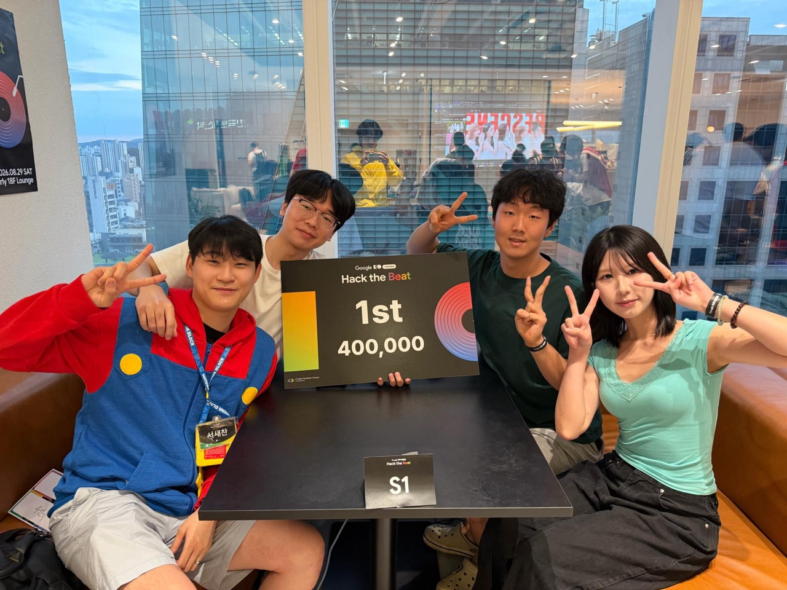
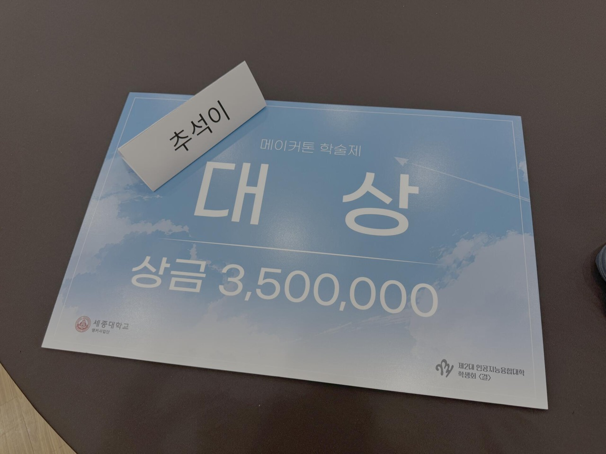
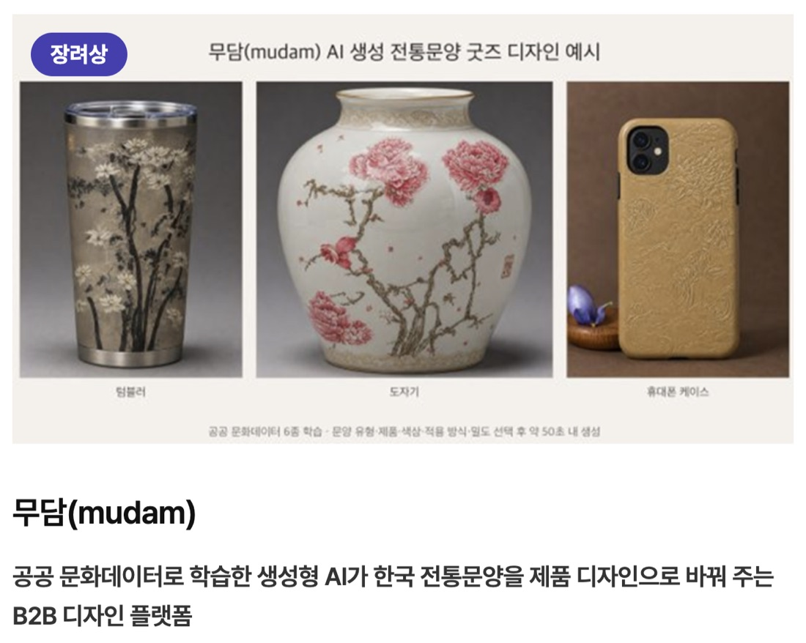
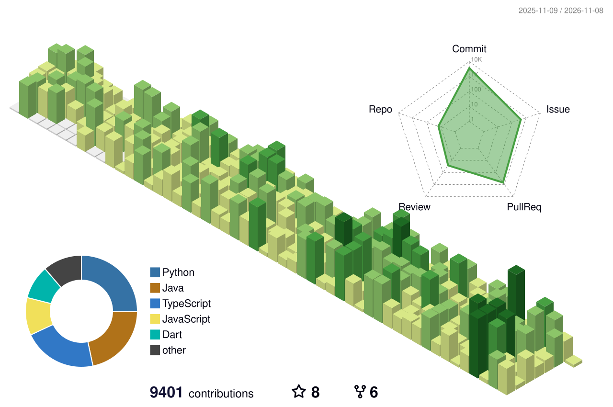

<!-- Header banner -->

<div align="center">
    <a href="https://git.io/typing-svg"></a>
</div>

<p align="center">
  <!-- Profile views counter (optional) -->
  
  
</p>

<p align="center">
  <a href="https://chuseok22.com"></a>
  <a href="https://www.linkedin.com/in/chuseok22/"></a>
  <a href="https://discord.com/invite/ncXEycT3Z9"></a>
  <a href="mailto:bjh59629@naver.com"></a>
</p>

---

## 👋 About Me

- **Full-stack developer** building **mobile-first apps** with **Ionic/Capacitor**, powered by **Spring Boot** and **Next.js**
- Interested in **scalable backend systems**, **CI/CD automation**, and **clean architecture**
- **Open to collaboration** — feel free to reach out, or drop by the [Chuseok22 Lab Discord](https://discord.com/invite/ncXEycT3Z9)

---

## 🧰 Tech Stack

---

<!-- shields.io badges (keep only what is needed) -->

### 📖 Language


### 🧑‍💻 Backend


### 📚 Frontend


### Database


###  DevOps


---

## 🚀 Featured Projects

Newest first. Projects without a repository link are in private repositories.

| Project | What it is | Role · Period | Stack | Links |
|---|---|---|---|---|
| **TeeQ** | Real-time voice companion with AI personas: call a character like a real phone call, build a relationship over time, and share your location with someone you trust on a late walk home. | Backend · Sep 2026 – now | Spring Boot, Flutter | [GitHub](https://github.com/Team-WDA/teeq-monorepo) |
| **WHO I'M** | Knowledge-succession service for companies: an AI interview turns a departing senior engineer's tacit judgment into evidence-linked handover cards. 🏆 Makeathon Grand Prize | Solo · Oct 2026 – now | Spring Boot, TypeScript | Private |
| **Waitee** | Customer-facing hybrid mobile app and web client for the Waitee service, with a strong focus on accessibility (screen-reader support). | Frontend · Jan 2026 – now | Next.js, React, Capacitor | Private |
| **Big Brother** | Sejong University capstone project: a multi-camera safety monitoring system with explainable alerts. | Backend · Oct 2026 – now | Spring Boot (Java 21) | Private |
| **ELUM** | Mobile service that helps people with developmental disabilities carry out their daily routines on their own, using step-by-step picture cards. | With [Saechan Seo](https://github.com/Cassiiopeia) and [Yeram Lee](https://github.com/yeramyyi) · Jul 2026 – now | Flutter, Spring Boot | [GitHub](https://github.com/Twin-Fang/elum) · [App Store](https://apps.apple.com/kr/app/id6792970508) · [Google Play](https://play.google.com/store/apps/details?id=kr.twinfang.elum) |
| **Hack the Beat: Party Passport** | Scan QR codes at a party, collect badges, and secretly match with the people you want to see again. Built in about three hours. 🏆 1st place | Team of four · Aug 29, 2026 | React, TypeScript, Spring Boot | [GitHub](https://github.com/Twin-Fang/Hack-the-Beat) · [Live demo](https://twin-fang.github.io/Hack-the-Beat/) |
| **MU:DAM (무담)** | B2B design platform where generative AI trained on public cultural data turns Korean traditional patterns into product designs. 🏅 Encouragement Prize | Solo · Jun – Sep 2026 | Kotlin, Spring Boot, PostgreSQL | [Website](https://culture.chuseok22.com) |

### Earlier Projects

| Project | What it is | Role | Links |
|---|---|---|---|
| **Sejong Malsami (세종말싸미)** | Study-material sharing and Q&A platform for Sejong University students, with a points system. | Backend | [GitHub](https://github.com/Sejong-Balsamic) · [Website](https://www.sejong-malsami.co.kr/) |
| **TicketMate** | Platform where skilled ticket buyers help others get concert and event tickets, built on trust-based matching and real-time chat. | Backend | [GitHub](https://github.com/Team-TicketMate) · [Website](https://www.ticketmate.site) |
| **RomRom** | AI-powered secondhand trading platform with a card-game style UX. | Backend | [GitHub](https://github.com/TEAM-ROMROM) · [Download APK](https://suh-project.synology.me/romrom/) |

---

## 🏆 Awards

<table>
  <tr>
    <td align="center" valign="top" width="33%">
      <br />
      <b>🥇 1st Place</b><br />
      <b>2026 I/O Extended: Hack the Beat</b><br />
      <sub>Aug 29, 2026 · Party Passport · Team of four, built in about three hours</sub><br />
      <sub><a href="https://github.com/Chuseok22">Jihoon Baek</a> · <a href="https://github.com/Cassiiopeia">Saechan Seo</a> · <a href="https://github.com/EM-H20">Euimin Hong</a> · <a href="https://github.com/yeramyyi">Yeram Lee</a></sub>
    </td>
    <td align="center" valign="top" width="33%">
      <br />
      <b>🏆 Grand Prize</b><br />
      <b>2026 Makeathon, College of AI Convergence, Sejong University</b><br />
      <sub>Nov 4, 2026 · WHO I'M · Solo entry (team "추석이")</sub>
    </td>
    <td align="center" valign="top" width="33%">
      <br />
      <b>🏅 Encouragement Prize</b><br />
      <b>4th Culture, Sports and Tourism AI &amp; Data Utilization Contest</b><br />
      <sub>Cultural Data Best Practice category · MU:DAM · Hosted by the Korea Culture Information Service Agency</sub>
    </td>
  </tr>
</table>

---

## 🚀 Utility Projects

| Project | Stars | Description | Link |
|---|---|---|---|
| [**project-auto-wizard**](https://github.com/Twin-Fang/project-auto-wizard) |  | Open-source tool: one command sets up versioning, CHANGELOG, GitHub Releases and CI/CD in your repo. Built with [Saechan Seo](https://github.com/Cassiiopeia) and [Yeram Lee](https://github.com/yeramyyi) | [npm](https://www.npmjs.com/package/project-auto-wizard) |
| [**Capacitor Kakao Native Login**](https://github.com/Chuseok22/capacitor-kakao-login) |  | Capacitor plugin for native Kakao social login (npm) | [npm](https://www.npmjs.com/package/@chuseok22/capacitor-kakao-login) |
| [**GitHub Issue Helper**](https://github.com/Chuseok22/github-issue-helper) |  | Generates GitHub branch names and commit messages automatically | [Marketplace](https://github.com/marketplace/actions/chuseok22-issue-helper) |
| [**Version Management**](https://github.com/Chuseok22/version-management) |  | Automated versioning workflow for Spring Boot and Next.js projects | [Marketplace](https://github.com/marketplace/actions/version-bump-compute-sync-changelog-tag?version=v1.0.0) |
| [**GitHub Template**](https://github.com/Chuseok22/chuseok22-github-template) |  | GitHub project template | — |
| [**Sejong Uni. Login**](https://github.com/Chuseok22/sejong-portal-login) |  | Sejong University portal login automation library | — |
| [**Swagger Api Change Log**](https://github.com/Chuseok22/api-change-log) |  | Tracks API change history in Swagger UI | — |
| [**PDF Extractor**](https://github.com/Chuseok22/pdf-extractor) |  | App that extracts data from PDFs and saves it to Excel | — |
| [**Excel Parser**](https://github.com/Chuseok22/excel-parser) |  | App that classifies data inside Excel files and exports it to separate Excel files | — |

---

## ⌨️ Coding Status

<sub>The stats in this section are generated automatically by a workflow and are written in Korean.</sub>

<!-- (dynamic) Marker where the WakaTime auto-update is inserted -->
<!--START_SECTION:waka-->


**🐱 저의 GitHub 정보에요.** 

> 📦 GitHub의 ?만큼의 저장소를 사용하고 있어요. 
 > 
> 🏆 7,453 만큼의 Contributions을 2026년에 했어요
 > 
> 🚫 구직중이지 않아요.
 > 
> 📜 38개의 Public Repository를 만들었어요. 
 > 
> 🔑 0개의 Private Repository를 만들었어요. 
 > 
**저는 아침형 인간이에요. 🐤** 

```text
🌞 아침                     133186 commits      ⬛⬛⬛⬛⬛⬜⬜⬜⬜⬜⬜⬜⬜⬜⬜⬜⬜⬜⬜⬜⬜⬜⬜⬜⬜   19.43 % 
🌆 낮　                     296271 commits      ⬛⬛⬛⬛⬛⬛⬛⬛⬛⬛⬛⬜⬜⬜⬜⬜⬜⬜⬜⬜⬜⬜⬜⬜⬜   43.22 % 
🌃 저녁                     161655 commits      ⬛⬛⬛⬛⬛⬛⬜⬜⬜⬜⬜⬜⬜⬜⬜⬜⬜⬜⬜⬜⬜⬜⬜⬜⬜   23.58 % 
🌙 밤　                     94378 commits       ⬛⬛⬛⬜⬜⬜⬜⬜⬜⬜⬜⬜⬜⬜⬜⬜⬜⬜⬜⬜⬜⬜⬜⬜⬜   13.77 % 
```
📅 **제가 가장 생산적인 날은 월요일이에요.** 

```text
월요일                      135464 commits      ⬛⬛⬛⬛⬛⬜⬜⬜⬜⬜⬜⬜⬜⬜⬜⬜⬜⬜⬜⬜⬜⬜⬜⬜⬜   19.76 % 
화요일                      135153 commits      ⬛⬛⬛⬛⬛⬜⬜⬜⬜⬜⬜⬜⬜⬜⬜⬜⬜⬜⬜⬜⬜⬜⬜⬜⬜   19.72 % 
수요일                      92326 commits       ⬛⬛⬛⬜⬜⬜⬜⬜⬜⬜⬜⬜⬜⬜⬜⬜⬜⬜⬜⬜⬜⬜⬜⬜⬜   13.47 % 
목요일                      98181 commits       ⬛⬛⬛⬛⬜⬜⬜⬜⬜⬜⬜⬜⬜⬜⬜⬜⬜⬜⬜⬜⬜⬜⬜⬜⬜   14.32 % 
금요일                      96762 commits       ⬛⬛⬛⬛⬜⬜⬜⬜⬜⬜⬜⬜⬜⬜⬜⬜⬜⬜⬜⬜⬜⬜⬜⬜⬜   14.12 % 
토요일                      62821 commits       ⬛⬛⬜⬜⬜⬜⬜⬜⬜⬜⬜⬜⬜⬜⬜⬜⬜⬜⬜⬜⬜⬜⬜⬜⬜   09.16 % 
일요일                      64783 commits       ⬛⬛⬜⬜⬜⬜⬜⬜⬜⬜⬜⬜⬜⬜⬜⬜⬜⬜⬜⬜⬜⬜⬜⬜⬜   09.45 % 
```


📊 **저는 이번주를 이렇게 시간을 보냈어요.** 

```text
🕑︎ Timezone: Asia/Seoul

💬 프로그래밍 언어들: 
Markdown                 8 hrs 44 mins       ⬛⬛⬛⬛⬛⬛⬛⬛⬛⬛⬛⬛⬜⬜⬜⬜⬜⬜⬜⬜⬜⬜⬜⬜⬜   49.10 % 
C                        2 hrs               ⬛⬛⬛⬜⬜⬜⬜⬜⬜⬜⬜⬜⬜⬜⬜⬜⬜⬜⬜⬜⬜⬜⬜⬜⬜   11.25 % 
Other                    1 hr 44 mins        ⬛⬛⬜⬜⬜⬜⬜⬜⬜⬜⬜⬜⬜⬜⬜⬜⬜⬜⬜⬜⬜⬜⬜⬜⬜   09.78 % 
TypeScript               1 hr 33 mins        ⬛⬛⬜⬜⬜⬜⬜⬜⬜⬜⬜⬜⬜⬜⬜⬜⬜⬜⬜⬜⬜⬜⬜⬜⬜   08.76 % 
YAML                     1 hr 14 mins        ⬛⬛⬜⬜⬜⬜⬜⬜⬜⬜⬜⬜⬜⬜⬜⬜⬜⬜⬜⬜⬜⬜⬜⬜⬜   06.96 % 

🔥 에디터들: 
Claude Code              14 hrs 50 mins      ⬛⬛⬛⬛⬛⬛⬛⬛⬛⬛⬛⬛⬛⬛⬛⬛⬛⬛⬛⬛⬛⬜⬜⬜⬜   83.36 % 
CLion                    2 hrs 31 mins       ⬛⬛⬛⬛⬜⬜⬜⬜⬜⬜⬜⬜⬜⬜⬜⬜⬜⬜⬜⬜⬜⬜⬜⬜⬜   14.15 % 
IntelliJ IDEA            25 mins             ⬛⬜⬜⬜⬜⬜⬜⬜⬜⬜⬜⬜⬜⬜⬜⬜⬜⬜⬜⬜⬜⬜⬜⬜⬜   02.39 % 
PyCharm                  1 min               ⬜⬜⬜⬜⬜⬜⬜⬜⬜⬜⬜⬜⬜⬜⬜⬜⬜⬜⬜⬜⬜⬜⬜⬜⬜   00.10 % 

🐱‍💻 프로젝트들: 
second-brain             6 hrs 29 mins       ⬛⬛⬛⬛⬛⬛⬛⬛⬛⬜⬜⬜⬜⬜⬜⬜⬜⬜⬜⬜⬜⬜⬜⬜⬜   36.49 % 
c-data-structure-study   2 hrs 31 mins       ⬛⬛⬛⬛⬜⬜⬜⬜⬜⬜⬜⬜⬜⬜⬜⬜⬜⬜⬜⬜⬜⬜⬜⬜⬜   14.15 % 
waitee-shop-admin        1 hr 35 mins        ⬛⬛⬜⬜⬜⬜⬜⬜⬜⬜⬜⬜⬜⬜⬜⬜⬜⬜⬜⬜⬜⬜⬜⬜⬜   08.89 % 
Big-Brother-BE           1 hr 34 mins        ⬛⬛⬜⬜⬜⬜⬜⬜⬜⬜⬜⬜⬜⬜⬜⬜⬜⬜⬜⬜⬜⬜⬜⬜⬜   08.87 % 
waitee-server            1 hr 32 mins        ⬛⬛⬜⬜⬜⬜⬜⬜⬜⬜⬜⬜⬜⬜⬜⬜⬜⬜⬜⬜⬜⬜⬜⬜⬜   08.63 % 

💻 운영 체제들: 
Mac                      17 hrs 48 mins      ⬛⬛⬛⬛⬛⬛⬛⬛⬛⬛⬛⬛⬛⬛⬛⬛⬛⬛⬛⬛⬛⬛⬛⬛⬛   100.00 % 
```

🤖 **AI Coding This Week** 

```text
⏱ AI Coding Time: 15 hrs 13 mins (85.49%)

✍️ 25,250 lines written by AI, 444 lines written by hand (98.27% AI-written)

🔤 21,639,997 Input Tokens, 1,849,174 Output Tokens

💵 $223.85 Estimated AI Cost This Week

🧠 39 AI Sessions, 312 AI Prompts

Sonnet                   14,481 lines        ⬛⬛⬛⬛⬛⬛⬛⬛⬛⬛⬛⬛⬛⬛⬜⬜⬜⬜⬜⬜⬜⬜⬜⬜⬜   57.03 % 
Opus                     10,226 lines        ⬛⬛⬛⬛⬛⬛⬛⬛⬛⬛⬜⬜⬜⬜⬜⬜⬜⬜⬜⬜⬜⬜⬜⬜⬜   40.27 % 
Fable                    501 lines           ⬜⬜⬜⬜⬜⬜⬜⬜⬜⬜⬜⬜⬜⬜⬜⬜⬜⬜⬜⬜⬜⬜⬜⬜⬜   01.97 % 
Haiku                    184 lines           ⬜⬜⬜⬜⬜⬜⬜⬜⬜⬜⬜⬜⬜⬜⬜⬜⬜⬜⬜⬜⬜⬜⬜⬜⬜   00.72 % 

🔎 AI Coding Insights:
🤖 AI-Driven — 98.27% of written lines came from AI
📚 Verbose Prompter — average 3,811 characters per prompt
🔁 Iterative Prompter — average 8 prompts per session
🚀 High AI Trust — 2.56% of changed lines were hand-edited
```

**저는 주로 Java 언어를 사용해요.** 

```text
Java                     24 repos            ⬛⬛⬛⬛⬛⬛⬛⬛⬜⬜⬜⬜⬜⬜⬜⬜⬜⬜⬜⬜⬜⬜⬜⬜⬜   30.00 % 
Python                   17 repos            ⬛⬛⬛⬛⬛⬜⬜⬜⬜⬜⬜⬜⬜⬜⬜⬜⬜⬜⬜⬜⬜⬜⬜⬜⬜   21.25 % 
TypeScript               15 repos            ⬛⬛⬛⬛⬛⬜⬜⬜⬜⬜⬜⬜⬜⬜⬜⬜⬜⬜⬜⬜⬜⬜⬜⬜⬜   18.75 % 
HTML                     3 repos             ⬛⬜⬜⬜⬜⬜⬜⬜⬜⬜⬜⬜⬜⬜⬜⬜⬜⬜⬜⬜⬜⬜⬜⬜⬜   03.75 % 
C                        2 repos             ⬛⬜⬜⬜⬜⬜⬜⬜⬜⬜⬜⬜⬜⬜⬜⬜⬜⬜⬜⬜⬜⬜⬜⬜⬜   02.50 % 
```


 Last Updated on 2026년 10월 15일 09:22:06 UTC UTC
<!--END_SECTION:waka-->

---

## 📊 GitHub Status

<!-- Basic stats cards -->




|  |  |
|---------------------------------------------------------------------------------------------------------------------------------------------------------------------------------------------------|---------------------------------------------------------------------------------------------------------------------------------------------------------------|
|                                                                                                                                     |                              |

<!-- Commit streak -->

<!-- Contribution graph -->


> *Note: Based on public repositories. Monorepos, forks, and generated files may skew the ratios.*

